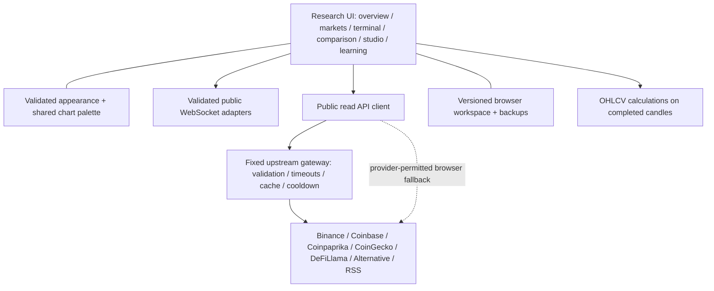

# CRYPTOZ 2.1 — Glass research desk

Built 17 November 2026. This release implements the user's video-inspired visual direction and adds transparent learning and live venue-price coverage to the functioning v2 application.

## Research → decisions

| Evidence | Decision in CRYPTOZ |
|---|---|
| User clip one: lavender canvas, white rounded cards, orange emphasis, clear typography | Lavender Day theme with an orange primary action and opaque white chart canvases |
| User clip two: cobalt/violet wallpaper, frosted navigation, thin bright borders | Default Midnight Glass theme, original generated 20 KB WebP wallpaper, translucent floating sidebar |
| [Coinbase Advanced dashboard](https://help.coinbase.com/en/coinbase/trading-and-funding/advanced-trade/dashboard-overview) separates interactive charting, book and trade information | Keep charts, venue identity, visible book depth and source status distinct. Do not combine aggregate USD and venue USDT prices |
| [CoinDCX indicator management](https://support.coindcx.com/articles/charts-indicators/can-i-add-or-manage-indicators-on-the-chart/688a11242d5f3b45db7ccf01) and [saved layouts](https://coindcx.com/blog/product-updates/how-to-save-chart-layouts-on-coindcx) | Retain selectable/configurable studies and named layouts. Appearance controls do not replace research state |
| [Binance chart guidance](https://www.binance.com/en/support/faq/detail/8419126024404348a1c6e4039fbed3fe) and [official streams](https://github.com/binance/binance-spot-api-docs/blob/master/web-socket-streams.md) | Use actual OHLCV and documented public streams; one all-market mini-ticker socket plus the selected instrument's kline/ticker/partial20 socket |
| [CCXT manual](https://github.com/ccxt/ccxt/wiki/manual) | Retain explicit venue adapters and centralized request coalescing, bounded caching, timeouts and cooldowns. CCXT is a reference; importing its entire runtime adds no necessary capability here |
| [Freqtrade lookahead analysis](https://github.com/freqtrade/freqtrade/blob/develop/docs/lookahead-analysis.md) | Signals and comparisons exclude unfinished candles; no invented historical profit, confidence or accuracy score |
| [Reddit discussion about disappearing studies/drawings](https://www.reddit.com/r/TradingView/comments/1e9n59u/) and [old-session overwrite reports](https://www.reddit.com/r/TradingView/comments/1ki3g84/) | Test settings and note preservation during theme changes; retain backups, import recovery and cross-tab conflict warnings |
| [web.dev animation guide](https://web.dev/articles/animations-guide), [MDN backdrop-filter](https://developer.mozilla.org/en-US/docs/Web/CSS/Reference/Properties/backdrop-filter), [reduced motion](https://developer.mozilla.org/en-US/docs/Web/CSS/Reference/At-rules/%40media/prefers-reduced-motion) | Static wallpaper; finite opacity/transform transitions; no animated blur or continuous decorative effects. Device preference and explicit Reduce Motion both supported |

Reddit posts are qualitative product feedback, not representative surveys or proof of competitor defects. Public product documentation establishes observable capabilities; proprietary exchange internals were not inspected or guessed. No competitor source, creator branding, example figures or code from the reference videos was copied.

## Implemented architecture

The existing vanilla JS/Vite architecture is retained. Lightweight Charts renders price history and studies; Apache ECharts is loaded only for visualization views. The self-contained Worker and Node launcher use the same gateway. No exchange login, wallet or trading credentials are needed. No orders are placed.

Appearance lives in a separate validated storage key, so changing a chart layout cannot unexpectedly change the whole app's theme. Theme changes update chart objects while leaving input forms intact. Repeated indicator updates reuse series. Learning refreshes reuse chart series and retain the visible range. Route navigation returns to the top; background refresh does not force scrolling.

## Live data: precise coverage

| Data | Actual delivery / limits |
|---|---|
| Binance live strip and active USDT exchange rows | Documented `!miniTicker@arr`; accepted only for the active instrument registry. Visible patches batch once per second. 24h change is calculated from the mini-ticker open and close. Quotes older than 15 seconds lose their live claim |
| Selected Binance chart | Kline and ticker streams; REST reconciliation and 15-second fallback. Current candle is provisional |
| Selected Binance book | Self-contained top-20 snapshots, nominally once per second; display top seven per side. Repeated equal-sequence snapshots remain valid fresh observations; backwards sequences are rejected. Receipt time is labeled because this payload has no event timestamp |
| Selected Coinbase chart | Public ticker stream, history checks every 15 seconds; Coinbase book remains an explicitly labeled REST snapshot |
| Asset directory | Coinpaprika aggregate USD snapshot; 2,000 assets observed in this verification. 10-minute gateway cache plus upstream lag. A listing does not establish credibility |
| Global totals | CoinGecko, with explicitly attributed Coinpaprika fallback; two-minute cache |
| Learning / comparison | Actual completed exchange candles. Learning checks every 15 seconds while visible; history has a 15-second cache. Comparison refreshes on request |
| TVL / news / sentiment | DeFiLlama five-minute cache; publisher RSS five-minute cache; Alternative.me daily index with one-hour cache |

Broad overview data checks every two minutes. Cache ages and provider observation times can differ. A market with no recent trades may retain an older quote. API quotas, regional restrictions, feed outages and tab suspension can interrupt service. The app shows unavailable, delayed, reconnecting or stale states and never fills gaps with simulated prices.

## Learning and tools

Six learning topics cover candles, trend, momentum, volatility, liquidity and risk. Conditions can be filtered to trend, momentum or volatility. Computed observations include EMA 20/50 alignment, Wilder RSI 14, MACD 12/26/9 histogram, Wilder ATR 14 and Bollinger position. Zero-width bands have undefined position. The last completed candle, interval, count, venue and fetch time are shown.

The advanced terminal retains candles/OHLC/line/Heikin-Ashi, EMA/SMA/Bollinger/VWAP overlays, RSI/MACD/volume panes, optional closed-bar EMA crossover markers, horizontal/trend/Fibonacci/annotation tools, editable anchors, layouts, CSV/PNG exports, risk calculator and instrument notes. Comparison retains aligned returns, drawdowns, volatility and correlations. The studio retains market-cap map, liquidity/momentum scatter, TVL and cumulative depth. News retains publisher and keyword filters and original article links.

These are descriptive research tools, not validated buy/sell recommendations. There is no backtested strategy-performance claim, order execution, liquidation feed, audited on-chain attribution or universal asset coverage.

## Verification

- 54 automated tests passed, including eight glass-release tests; dependency audit reported zero known vulnerabilities at verification time.
- Twelve actual provider-backed API checks returned HTTP 200. Evidence includes directory, totals, sentiment, news, TVL, both instrument registries, exchange tickers, Binance candles/book/ticker and Coinbase four-hour candles.
- Production build passed. The production Node server returned the wallpaper as `image/webp`, enforced the configured CSP and successfully loaded the lazily bundled ECharts views. A development-only outdated Vite optimized-dependency cache was isolated by testing the production bundle; no such dependency URL exists in the production artifact.
- Browser checks covered both themes, desktop 1440×1000, mobile 390×844 and narrow 320×800; no page-width overflow in sampled mobile routes. Internal market-table horizontal scrolling is intentional.
- Actual Binance quotes and book receipts changed in the browser. Learning and comparison loaded genuine Binance and Coinbase history. Theme switching retained risk entry/calculation, notes and existing study parameters. Reduce Motion retained its setting.
- Exported OHLCV CSV contained 500 actual bars and venue/quote columns. PNG export included an editable horizontal drawing in the selected theme color. Temporary QA note/drawing were removed after checks.
- A controlled in-app browser diagnostic observed 23 frame intervals: p95 6.2 ms, maximum 12.2 ms, last route JavaScript 3.4 ms. This brief sample is not a device-independent FPS or stutter-free guarantee; it excludes provider/network latency.
- Fresh independent read-only code review found five edge cases; all were fixed. New regressions cover malformed ticker dates, zero-width Bollinger position and equal-sequence book freshness. Reviewer confirmed no remaining P1/P2 findings in follow-up. This is finite verification, not proof that software has zero bugs.

Runtime evidence and hosted acceptance are recorded in the accompanying output report. Existing workspace migration, alert freshness, backup validation, import recovery, quantitative math and provider-failure tests remain in the suite.

## Practical limits and next engineering stage

This release does not establish superiority over Binance, Coinbase, CoinDCX or TradingView. Those products have execution, regulated account operations, licensed feeds and capabilities outside this research app. Production expansion would need licensed data agreements, authenticated encrypted cross-device storage, historical-data persistence, continuous provider monitoring and sustained multi-device/load/accessibility testing. Browser-local research is unencrypted and is not account-synchronized. Alerts require this tab to remain open.

Run the portable build with `START-CRYPTOZ.cmd` on Windows with Node 22+ and internet. For development: `npm ci`, `npm run dev`. For a rebuilt production app: `npm run build`, `npm start`.
