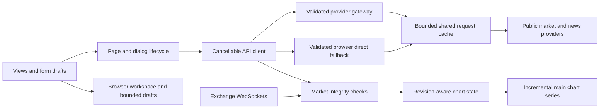

# Reliability architecture

CRYPTOZ retains a small Vite client, Lightweight Charts, lazily loaded ECharts, and one provider gateway shared between a hosted Worker and the portable Node server. A framework migration would not itself fix the observed races. The changes establish testable boundaries around the failures instead.

| Boundary | Responsibility |
| --- | --- |
| `market-integrity.js` | Normalize books, validate quote identity/time and merge history without rolling back newer observations |
| `chart.js` | Own one instrument generation, network lifetime, series updates, view range and disposal |
| `api.js`, `async-task.js` | Hosted/direct transport, parent cancellation, finite deadlines and ordered transport observations |
| `server/cache.js` | Coalesced requests with independent subscribers, finite cache/pending bounds and cancellation-aware retry |
| `server/node-adapter.js` | Adapt Node HTTP to Worker-style requests and cancel when the connection ends |
| `data-loader.js`, `page-refresh.js` | Independent dataset completion and explicit active-tool refresh |
| `dialog.js` | Modal lifetime, focus restoration, inert background and request cancellation |
| `draft-store.js`, `state.js` | Bounded unfinished drafts; validated, transactional workspace replacement |
| `visual-controller.js` | Reuse a visualization canvas and dispose it once |
| `numbers.js`, `exports.js` | Truthful numeric representation and bounded export artifacts |

Runtime bounds include a 160-entry provider cache, 32 pending provider tasks, 32 transport observations, 600 retained terminal bars, 20 risk drafts and ten monitored active alerts. Provider work is limited to fixed upstreams and validated routes. Caches are process/Worker-instance local, not a distributed quota or persistence service.

The visual system uses a static compressed wallpaper, fixed compact left rail, transparent header, contextual tabs and finite transitions. No particle or pointer-lighting loop runs. Glass can be explicitly chosen; device transparency and reduced-motion preferences have fallbacks. No numerical FPS claim is made.

Useful later work requires measured demand: licensed data/redistributed-feed rights, shared rate budgets, persistent user accounts, centralized monitoring and cross-device synchronization. These are not silently simulated by the current private single-browser research product.
